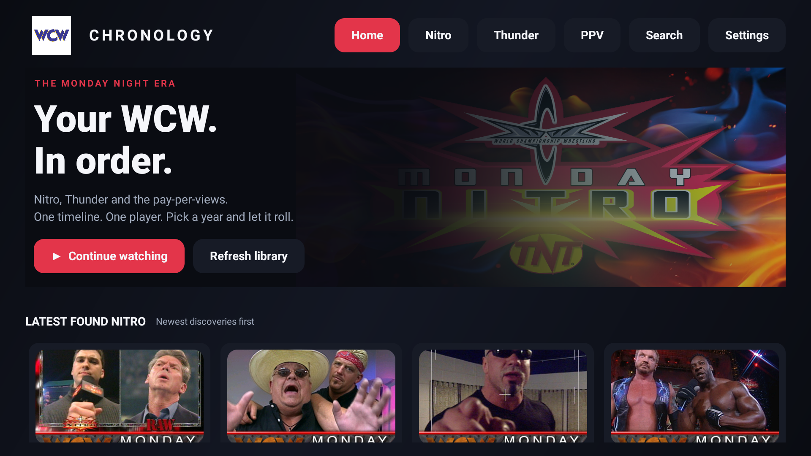

# WCW Chronology

## Install with Downloader on Fire TV

**Downloader code: `7990024`**

**Short URL: [aftv.news/7990024](https://aftv.news/7990024)**

1. Install and open **Downloader by AFTVnews** on your Fire TV or Fire Stick.
2. Enter **`7990024`** in Downloader's URL field and select **Go**.
3. Download the APK. If prompted, allow Downloader to install unknown apps in Fire TV settings, then return and select **Install**.
4. Open **WCW Chronology** from your apps.

[Download the latest APK directly](https://github.com/deklol/WCW-FireTV-App/releases/latest/download/WCW-FireTV-App.apk)

A Fire TV app for watching the Monday Night era in order. Pick a year, press **Play all**, and watch the available Nitro, Thunder and PPV broadcasts in one built-in player.

Created by [digitalm1nd](https://x.com/digitalm1nd).

## Video sources and streaming

I do not host any of the videos available through this app. Videos are sourced from the **official WCW YouTube channel** and **Archive.org collections**, and streamed directly from those providers. The app does not download or save video files to your device. This repository and its APK contain no episode video files.

## Features

- Dark TV interface, artwork, event descriptions and remote-friendly cards.
- Top navigation: **Home · Nitro · Thunder · PPV · Search · Settings**, with year filters in each show catalogue. Home returns to the homepage.
- Separate **Latest found Nitro**, **Latest found Thunder** and **Latest found PPVs** rows, directly below the hero. Newest discoveries appear first; broadcasts discovered together use newest broadcast date first. Playback queues remain chronological.
- Year queues covering 1997 through WCW's final broadcast in March 2001. Unavailable episodes are omitted.
- Automatic next episode, resume positions, watched markers, search and optional Saturday Night, Worldwide and Pro shows.
- Direct streaming from public Archive collections and the official WCW YouTube playlists, without opening an external app.
- Original English YouTube audio, H.264 video and a default 720p maximum suitable for the tested Fire Stick.
- Automatic source checks scheduled every six hours. Checks pause for this app's playback. A broken host does not cancel other source checks.
- Visible scan progress and a report of skipped sources and their reasons. New episodes and extra links for existing episodes are counted separately.
- Conditional HTTP metadata caching, source-list fingerprints and bounded artwork caching. **No video downloads or disk video cache.**
- App-update checking via a configurable HTTPS release manifest; see [app updates](docs/UPDATING.md).

## Install

Use the Downloader code **`7990024`** above, or [download the latest APK from GitHub Releases](https://github.com/deklol/WCW-FireTV-App/releases/latest/download/WCW-FireTV-App.apk). The supplied share folder also includes the original APK under `release/` with a SHA-256 checksum.

On Fire TV, allow installation for your chosen installer, transfer the APK and install it. The app appears as **WCW Chronology**. It needs no PC, server, YouTube account, Netflix account, root access or replacement launcher after installation.

The tested device is **Fire TV Stick HD, AFTSS (sheldon), Fire OS 7.7.1.7**. The app requires Android 9/API 28 or newer. Other devices are not claimed as tested.

## Watch in order

Open a year and choose **All → Play all**. The queue combines Nitro, Thunder, PPVs and available Clash events by original broadcast date. Starting an episode from a homepage row also continues through its year's complete timeline. A filtered library's Play all respects that filter. A year queue stops at the end of that year.

While playing, press Back once to hide visible controls. Press Back with the controls hidden to return to the library. Use the remote's play/pause and fast-forward/rewind buttons normally.

## Add or remove sources

Edit **[`sources.json`](sources.json)** in the repository root and rebuild. It contains readable, named entries for the YouTube playlists and Archive collection IDs. Entries can be added, removed or switched off with `"enabled": false`; no player-code edits are required for these supported source types.

See [source configuration](docs/SOURCES.md) for examples and matching rules. The large bundled `catalogue.json` is generated seed data, not the place to maintain the source list.

## Build and contribute

See [building](docs/BUILDING.md), [code structure](docs/ARCHITECTURE.md) and [contributing](CONTRIBUTING.md). The Gradle wrapper, app code, tests, initial catalogue and required app assets are included. Gradle obtains the declared open-source dependencies; no files from the original developer's PC are required.

## Licence and attribution

App source code: **GPL-3.0-or-later**. You may study, modify and redistribute it under that licence; see [LICENSE](LICENSE). Dependency and artwork attribution is in [THIRD_PARTY_NOTICES.md](THIRD_PARTY_NOTICES.md).

This is an independent fan project, not affiliated with WWE, WCW, YouTube or the Internet Archive. Videos remain on their respective providers; the repository contains catalogue references, not episode video files. Host availability and YouTube extraction can change independently of this app.
